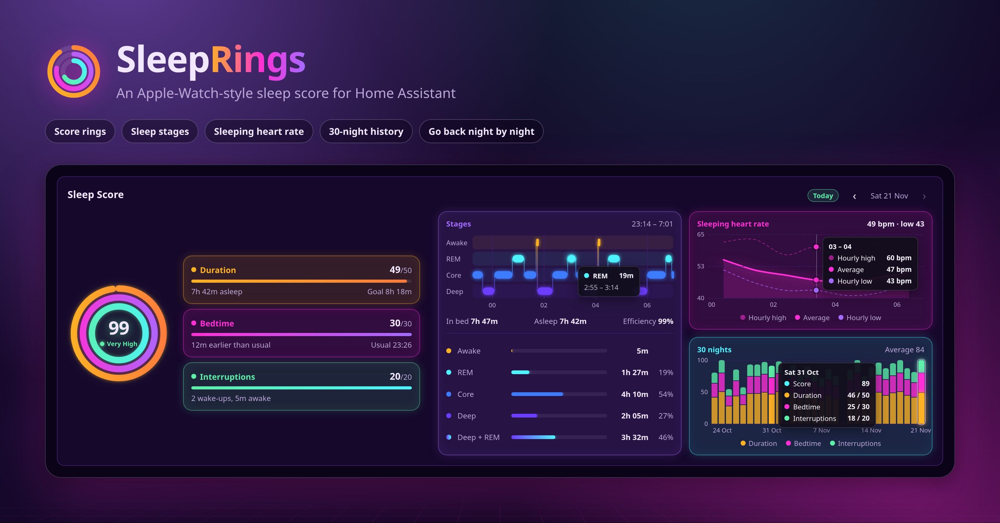
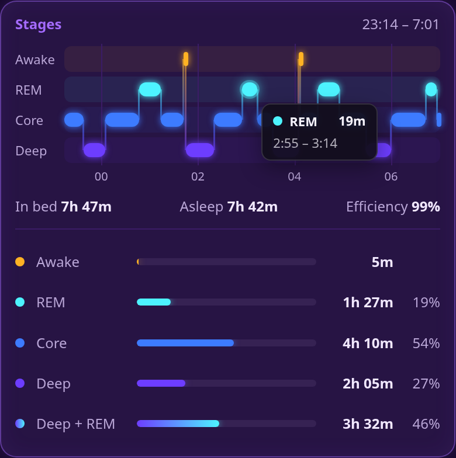
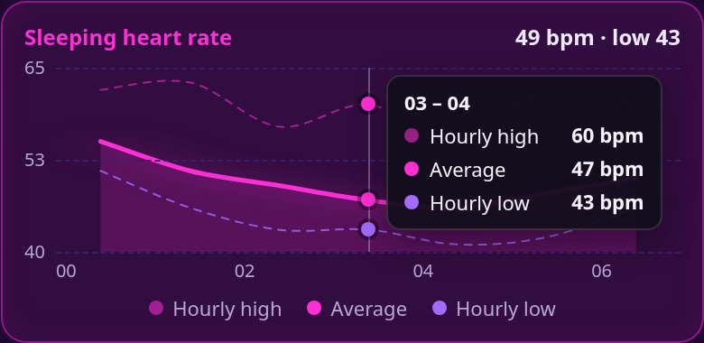
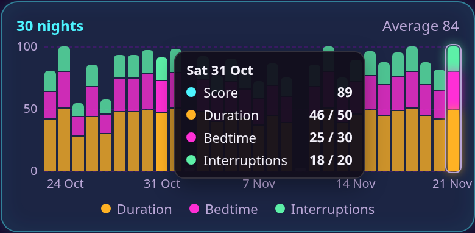
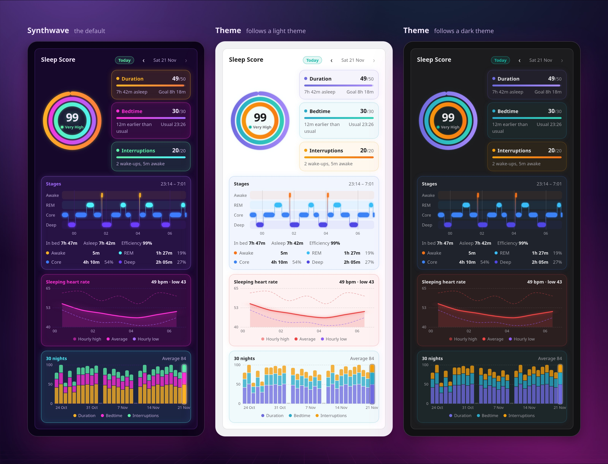

# SleepRings

<p align="center">
  
</p>

<p align="center">
  <a href="https://github.com/MulletBoy/sleeprings/releases/latest"></a>
  <a href="https://github.com/MulletBoy/sleeprings/actions/workflows/test.yml"></a>
  <a href="https://github.com/MulletBoy/sleeprings/actions/workflows/validate.yml"></a>
  
  <a href="LICENSE"></a>
  <a href="https://ko-fi.com/mulletboy"></a>
</p>

<p align="center">
  <a href="#install">Install</a> ·
  <a href="#the-rings-family">The Rings family</a> ·
  <a href="#whats-new">What's new</a> ·
  <a href="#the-card">The card</a> ·
  <a href="#the-formula-model-v5">The formula</a> ·
  <a href="#how-accurate-is-it">Accuracy</a> ·
  <a href="#privacy">Privacy</a>
</p>

A sleep score for Home Assistant in the style of the Apple Watch Sleep Score: 0 to 100, made of
**Duration** (50), **Bedtime** consistency (30) and **Interruptions** (20), with a dashboard card
that shows it as rings, a scorecard, the night's sleep stages, sleeping heart rate and a 30-night
history. It is part of the [Rings family](#the-rings-family), alongside
[VitalRings](https://github.com/MulletBoy/vitalrings).

SleepRings is one install: a custom integration that calculates the score, and a card that the
integration loads into your dashboards by itself.

SleepRings is free and stays free. If it earns a place on your dashboard, you can
[buy me a coffee on Ko-fi](https://ko-fi.com/mulletboy). ☕

| Sleep stages | Sleeping heart rate | 30 nights |
|---|---|---|
|  |  |  |
| Hover or tap a stage for its times. Minutes and share of each stage below. | The night's average and low, with the hourly range. | Each night split into its three parts. Click a bar to open that night. |

Three looks, and every colour can be changed:

<p align="center">
  
</p>

<sub>The screenshots show invented sample nights, not anyone's sleep.</sub>

> SleepRings is an independent project. It is not made by, affiliated with or endorsed by Apple.
> watchOS does not expose its Sleep Score to other apps, so SleepRings estimates it from the sleep
> data Apple Health does share. See [How accurate is it?](#how-accurate-is-it)

## The Rings family

SleepRings is one of a family of Home Assistant apps that turn the health data from your watch
into rings you want to close. They share one look, install the same way and sit side by side on
a dashboard. Each works on its own; together they cover your night and your day.

| | App | What it scores |
|---|---|---|
|  | **SleepRings** (you are here) | Your night: an Apple-Watch-style sleep score from duration, bedtime and interruptions, with sleep stages, sleeping heart rate and a 30-night history. |
|  | **[VitalRings](https://github.com/MulletBoy/vitalrings)** | Your body: heart, recovery and breathing, sleeping heart rate, blood oxygen and VO2 max, with heart rate, VO2 max and weight charts. |

More may follow.

## What you need

- Home Assistant 2026.11 or newer.
- Sleep data with a start time and, ideally, sleep stages. Today SleepRings supports one source:
  [Life Dashboard](https://github.com/owen282000/life-dashboard-ha) with its iOS companion app,
  which sends Apple Health data to Home Assistant. Version 1.4.0 or newer is recommended: from there
  SleepRings reads past nights through an action Life Dashboard provides for it.
- The stock Home Assistant companion app is not enough: it only reports totals, with no time you
  fell asleep and no stages.

Other sources can be added through a small adapter; see [Adding a source](#adding-a-source).

## Install

[](https://my.home-assistant.io/redirect/hacs_repository/?owner=MulletBoy&repository=sleeprings&category=integration)

1. Open **Settings > Marketplace**, choose **Add from link** and paste
   `https://github.com/MulletBoy/sleeprings` (type: Integration). On Home Assistant versions before
   2026.11 with HACS: **HACS > Custom repositories**.
2. Download **SleepRings** and restart Home Assistant.
3. Go to **Settings > Devices & services > Add integration > SleepRings**.
4. Pick your sleep entity (for Life Dashboard: the sensor ending in `_last_sleep_asleep`), and
   optionally a time zone entity (see [Time zones](#time-zones)).

Manual install: copy `custom_components/sleep_rings` into your `config/custom_components` folder
and restart.

## What's new

| Version | In short |
|---|---|
| **1.2.0** | Past nights are now read through Life Dashboard's own action, `life_dashboard.get_sleep_nights`, added to Life Dashboard 1.4.0 for this purpose, where SleepRings used to read its internals. Nothing changes in what you see, and older Life Dashboard versions keep working the old way for now. Update Life Dashboard to 1.4.0 or newer when you can. |
| **1.1.1** | A night with no recording (watch not worn) now shows as an empty day when you step through nights, where 1.1.0 skipped over it. |
| **1.1.0** | **Go back in time:** arrows and a date picker beside the date, or click a bar in the history. **Hover or tap** a sleep stage, an hour of the heart-rate chart or a history bar for its detail. The **history** now stacks each night into Duration, Bedtime and Interruptions (`history_style: bands` brings the old look back). Stage timelines are kept for every night from this version on. |
| **1.0.1** | Build and dependency updates only. Nothing changes in use. |
| **1.0.0** | First release: the score (model v5), its sensors and long-term statistics, and the card with rings, scorecard, sleep stages, sleeping heart rate and history. |

Full notes for every version are on the [releases page](https://github.com/MulletBoy/sleeprings/releases).

## The card

Add a card and search for **Sleep Rings**, or use YAML:

```yaml
type: custom:sleep-rings-card
entity: sensor.sleep_sleep_score
```

The card has a visual editor. All options:

| Option | Default | What it does |
|---|---|---|
| `entity` | required | The sleep score sensor of a SleepRings device |
| `name` | `Sleep Score` | Title |
| `preset` | `synthwave` | `synthwave` (neon on a dark card), `theme` (follows your light or dark theme) or `health` (colours close to the Health app) |
| `ring_style` | `concentric` | `concentric`: three rings, each filling to its own maximum. `segmented`: one 100-point ring split 50 / 30 / 20 |
| `tiles` | from the preset | Tinted boxes around each part |
| `theme_background` | `false` | Keep your theme's card background even with the Synthwave preset |
| `show_rows` | `true` | The scorecard rows with the measurement behind each part |
| `show_hypnogram` | `true` | Last night's sleep stages |
| `show_history` | `true` | Score history, one bar per night coloured by band |
| `show_heart_rate` | `true` | Sleeping heart rate with the night's low (only when the source provides it) |
| `sleep_goal_hours` | model value | The goal shown on the Duration row. Default: the duration that earns full points (8.3 h in model v5) |
| `history_nights` | `30` | Nights of history to show (the integration keeps 60) |
| `history_style` | `components` | `components`: each night's bar is stacked into Duration, Bedtime and Interruptions. `bands`: one bar per night, coloured by band |
| `colors` | | Override single colours, see below |

What the card shows beside the rings:

- **Duration** with your sleep goal, **Bedtime** with your usual bedtime (the average time you fell
  asleep over the previous 13 nights, which is what the score compares against), and **Interruptions** with wake-ups and minutes awake.
- **Stages**: the night's timeline plus the minutes of each stage and its share of the time asleep.
- **Sleeping heart rate**: the night's average, its low and the hourly trend.
- A marker beside the date: **Today** when the night shown ended today, **Yesterday** (or
  "3 days ago") while no sleep has been recorded for today yet.
- **Earlier nights**: the arrows beside the date step back and forward one day (a night with no
  recording is shown as empty, not skipped), the
  date opens a date picker, and clicking a bar in the history opens that night. Stage timelines
  are kept from the day SleepRings 1.1 is installed (plus whatever your source still holds).
- **Hover or tap** a sleep stage, an hour of the heart-rate chart or a history bar for its
  detail.

The card adapts to its width: rings above the rows in a narrow column, two columns from 640 px,
and everything side by side from 960 px. In a sections dashboard, give it more room with
`grid_options: { columns: full }` in a wider section.

### Colours

```yaml
type: custom:sleep-rings-card
entity: sensor.sleep_sleep_score
preset: theme
colors:
  duration: "#6e6adf"
  duration_end: "#a78bfa"   # optional: the ring fades from the first colour to this one
  very_high: "#14b8a6"
  deep: "#4f46e5"
```

Keys: `duration`, `bedtime`, `interruptions` (each with an optional `_end`), the bands `very_low`,
`low`, `ok`, `high`, `very_high`, and the stages `awake`, `rem`, `core`, `deep`.

A Home Assistant theme can set the same colours for the `theme` preset with variables such as
`sleep-rings-duration-color` or `sleep-rings-deep-color`.

## Entities

One device per person, with these sensors:

| Sensor | Value |
|---|---|
| Sleep score | 0 to 100 |
| Duration points, Bedtime points, Interruptions points | The three parts, out of 50, 30 and 20 |
| Sleep score band | Very Low, Low, OK, High, Very High |
| Time asleep, Bedtime compared with usual, Wake-ups, Time awake | The measurements behind the parts (diagnostic) |
| Sleeping heart rate, Lowest sleeping heart rate | Average and lowest heart rate between falling asleep and waking, from the source's hourly heart rate. Only hours completely inside the night count, so falling asleep and getting up do not; the chart also shows the first and last partial hour. Not part of the score |

The score sensor's attributes carry what the card shows: the night (wake date), the parts, the
measurements, the stage timeline, the 13 earlier bedtimes the night was compared with, up to 60
nights of history, the model version and the constants in use.

Long-term statistics named `sleep_rings:<entry id>_score` (and `_duration_points`,
`_bedtime_points`, `_interruptions_points`) hold one value per night, dated on the day you woke
up, so charts stay correct when data arrives late.

The action `sleep_rings.recalculate` scores every stored night again.

The card reads earlier nights through the WebSocket command `sleep_rings/night`
(`entity_id`: any SleepRings entity, `night`: the wake date as `YYYY-MM-DD`). It returns the
same fields as the score sensor's attributes, for that night.

## The formula (model v5)

```
score = round(D + B + I)

D = 50 - 3.1 x (8.3 - hours_asleep)^2          50 at 8.3 h or more, never below 0

dev = tonight's sleep onset - mean onset of the previous 13 nights   (minutes)
later   (dev > 0):  B = 30 - 0.225 x max(0, dev - 17)
earlier (dev <= 0): B = 30 - 0.4 x sqrt(max(0, -dev - 40))            never below 0

I = 20 - 1.2 x max(0, wakeups - 3) - 0.08 x max(0, minutes_awake - 16)   never below 0
```

Bands: Very Low 0-40, Low 41-60, OK 61-80, High 81-95, Very High 96-100.

How the inputs are taken:

- **Hours asleep** is time actually asleep (Core + Deep + REM, or "Asleep" without stages), not
  time in bed. Sleep stages do not otherwise change the score.
- **One main night per day.** A night belongs to the day you wake up. If a day has several
  sessions, the one with the most sleep counts; naps do not.
- **Onset** is the start of the first asleep stage. Onsets are averaged as minutes after noon, so
  23:30 and 00:30 average to midnight.
- **A wake-up** is an awake stretch of at least 0.9 minutes between falling asleep and the final
  wake-up. Minutes awake are all awake minutes in that window.

Every number above is a setting (**Configure** on the integration, under "Formula constants").
Changing one rescores all stored nights. The write-up of how the model was fitted is
[this gist](https://gist.github.com/MulletBoy/5025c85c276bb70854879ea5e57153dd).

### Time zones

Bedtimes are compared in the local time of the place you slept. If you travel, pick a time zone
entity during setup: the iOS companion app's `sensor.<phone>_geocoded_location` works (its
"Time Zone" attribute). Each night is stored with the zone the phone was in when the night
arrived. Without such an entity, Home Assistant's own time zone is used.

## How accurate is it?

Be clear about what this is: a model fitted to Apple's results, not Apple's code.

- Apple publishes the structure (50 + 30 + 20, bedtime against the last 13 nights, interruptions
  from how often and how long you wake) but not the curves.
- Model v5 was fitted to 14 nights of one person's data, using the measurements and points the
  Health app shows for each part. On those nights the total is exact on 8 of 14 and never more
  than 1 point off; each part is within about 1 point. Leaving one night out of the fit at a
  time, the average error is about 0.5 points per part. These 14 nights are the unit tests in
  this repository.
- It has been checked on 5.5 to 10.2 hours asleep, bedtimes from 4 h 24 min early to 2 h 17 min
  late, and 1 to 8 wake-ups. Outside those ranges it is extrapolating.
- Weak spots: very restless nights (only two in the data) and nights between 7.8 and 9.3 hours,
  which is where the duration cap sits.
- It is one person's data. Apple may personalise the score, and can change it in any update.
- Your inputs can differ slightly from Apple's. A few minutes, or a different choice of main
  night, can move a part by a point.
- Nights imported from before SleepRings was installed may have no stage data. Their wake-up
  count is unknown, so they are marked `estimated` and drawn dimmed in the history.

If your scores are consistently off, the constants are there to be changed, and a pull request
with your own calibration nights is very welcome.

## Privacy

SleepRings never sends anything anywhere: it makes no network requests and loads nothing from
outside your Home Assistant. Still, it handles health data, so it helps to know where that data
sits:

- **Entity attributes.** The score sensor carries up to 60 nights of scores, the 13 bedtimes a
  night was compared with, last night's stage timeline and hourly heart rate. Like all entity
  state, every user of your Home Assistant can read this, and anything that exports states
  (MQTT statestream, InfluxDB, a cloud backup) will include it.
- **Storage.** Up to 90 nights, with their stage timelines, are kept in a file under `.storage`, readable only by Home
  Assistant's own user, and included in Home Assistant backups.
- **Recorder.** Sensor history and long-term statistics, as for any sensor.
- **Diagnostics.** The diagnostics download contains no sleep times, bedtimes, heart rate, time
  zone or entity ids, so it is safe to attach to a bug report.
- **The card file** is served without a login, like every Home Assistant frontend file. It
  contains only code, never your data.

Removing the integration deletes its storage file and its dated statistics
(`sleep_rings:...`). The sensors' own history and statistics stay until the recorder purges them
or you delete them under **Developer tools > Statistics**.

## Adding a source

Sources live in `custom_components/sleep_rings/sources/`. A source is a small class that turns
another integration's data into `Night` objects (wake date, start, end, minutes asleep, optional
stages); see `life_dashboard.py` and the `SleepSource` protocol in `sources/__init__.py`.
Everything after that (main night, onset, wake-ups, scoring, storage) is shared.

## Development

```bash
pip install -r requirements-test.txt   # Python 3.14.2 or newer
pytest

cd card
npm install
npm run build                          # also copies the bundle into the integration
node demo/build-demo.mjs               # dist/demo.html: the card with sample nights
```

The images in this README are taken from `dist/demo.html?showcase`.

The formula is in `custom_components/sleep_rings/formula.py`, with every constant in one
dataclass and `MODEL_VERSION` next to it.

## Support

SleepRings is a hobby project and free to use. Bug reports, calibration nights and pull requests
are the most useful support. If you would like to say thanks another way, there is
[Ko-fi](https://ko-fi.com/mulletboy).

## Credits

- Reddit user [u/thegamer93](https://www.reddit.com/user/thegamer93), whose feedback on an
  earlier version shaped model v5: that it had too many constants for the nights it was
  fitted to, that the duration cap was not pinned down by the data, and that minutes awake
  count towards interruptions.
- [ChromaFlow](https://github.com/Aresitoo/chromaflow) by AresLab inspired the look of the rings
  and scorecard.
- [Life Dashboard](https://github.com/owen282000/life-dashboard-ha) by Owen Vogelaar provides the
  sleep data.

## Licence

[MIT](LICENSE)
